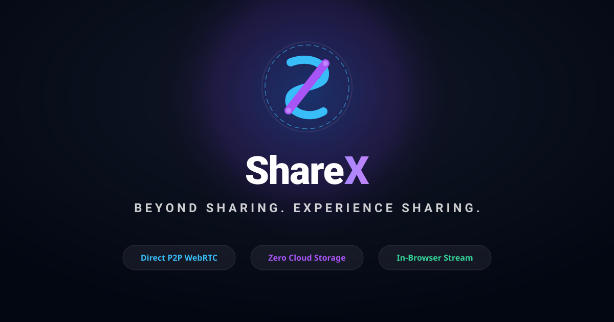

# ShareX — Beyond Sharing. Experience Sharing.



> **ShareX** is a professional, high-performance, storage-free peer-to-peer file sharing and live media streaming web application built with direct WebRTC DataChannels, cinematic Liquid Glass aesthetics, adaptive performance scaling, and zero cloud storage.

---

## Key Highlights

- **Storage-Free P2P Architecture**: Direct memory-to-memory WebRTC DataChannel transfer. No files are uploaded to GitHub, Cloudflare Workers, or cloud buckets.
- **Cinematic Liquid Glass Interface**: Midnight dark aesthetic, translucent glassmorphism (`backdrop-filter`), electric blue & violet accents, and over 50 purposeful animations.
- **5-Stage Cinematic Introduction**: Authentic animated opening experience with logo expansion, glowing light-rings, title and tagline reveal.
- **In-Browser Media Streaming & File Viewers**:
  - **Cinematic Video Player**: Progressive buffer streaming, scrub bar, PiP, fullscreen, speed selector, and 3-second auto-fading controls.
  - **Animated Music Player**: Vinyl disc rotation, dynamic waveform visualizer, mini floating bar, and seek controls.
  - **PDF & Document Reader**: Page rendering, text parsing, zoom, fullscreen, and download.
  - **Image Lightbox**: Pan & drag, scroll zoom, and fullscreen inspection.
- **Resilient WebRTC Signaling**: Cloudflare Worker WebSocket/HTTP endpoint paired with an instant in-browser `BroadcastChannel` fallback for local multi-tab and offline network testing.
- **Cryptographic SHA-256 Verification**: Automatic integrity hashing via Web Crypto API ensures byte-for-byte fidelity.
- **Backpressure & Streaming Engine**: Buffered amount monitoring prevents browser RAM ballooning on large files.
- **Adaptive Performance Engine**: Auto Optimization, Battery Saver (throttled canvas/blur), Balanced, and Ultra modes.
- **PWA & Offline Shell**: Installable Progressive Web App with service worker shell caching and app shortcuts.

---

## Directory Structure

```
SHAREX/
├── index.html                  # Master application shell
├── manifest.json               # Progressive Web App manifest
├── service-worker.js           # Offline application shell caching & update manager
├── build-assets.js             # SVG & PNG asset generator
├── assets/
│   ├── logos/                  # Monogram SVGs, wordmark, splash, OG card
│   │   ├── logo.svg
│   │   ├── sx-monogram.svg
│   │   ├── sx-monogram-blue.svg
│   │   ├── sx-monogram-violet.svg
│   │   ├── splash-logo.svg
│   │   └── og-preview.svg
│   └── icons/                  # Favicons and PWA icons
│       ├── favicon.svg
│       ├── favicon.ico
│       ├── icon-192.png
│       └── icon-512.png
├── css/
│   ├── core.css                # Liquid Glass variables, themes, reset, utilities
│   ├── animations.css          # 50+ cinematic animations & keyframes
│   ├── mobile.css              # Mobile floating dock, touch layouts, safe areas
│   ├── desktop.css             # Desktop sidebar, dropzone anywhere, mouse glow
│   └── player.css              # Video, Music, PDF, and Image viewer styles
├── js/
│   ├── app.js                  # Application coordinator, splash lifecycle, statistics
│   ├── navigation.js           # Page routing, transition coordinator, shortcuts
│   ├── qr-engine.js            # Zero-dependency QR SVG generator & camera scanner
│   ├── pairing.js              # Pairing codes (K7M-PQ29-XR), timers, consent prompt
│   ├── webrtc.js               # RTCPeerConnection, STUN/TURN, signaling fallback
│   ├── transfer.js             # 64KB binary chunk engine, backpressure, SHA-256
│   ├── streaming.js            # Progressive chunk-to-blob & MediaSource streaming
│   ├── media-player.js         # Video player with auto-fade & music player with waveform
│   ├── document-viewer.js      # PDF & text reader with zoom and fullscreen
│   ├── image-viewer.js         # Image lightbox with pan and zoom gestures
│   ├── notifications.js        # Notification drawer, toast alerts, badge counter
│   ├── settings.js             # Themes, performance modes, ICE configuration
│   └── sound.js                # Web Audio API synthesized audio feedback
├── worker/
│   ├── signaling.js            # Cloudflare Worker WebRTC signaling server
│   ├── configuration.js        # Signaling parameters and rate-limiting
│   └── wrangler.toml           # Cloudflare deployment configuration
└── docs/
    ├── ARCHITECTURE.md         # Detailed architectural documentation
    ├── FEATURE_MATRIX.md       # Implementation & audit verification matrix
    ├── DEPLOYMENT.md           # GitHub Pages & Cloudflare deployment guide
    ├── TESTING.md              # Test checklist and validation procedures
    ├── SECURITY.md             # Security architecture & consent protocols
    └── CHANGELOG.md            # Release changelog and version history
```

---

## Quick Start

### 1. Static Execution (Local Browser)
Because ShareX is engineered with standard vanilla web standards, it requires zero compile steps:
```bash
# Serve with any static web server (Node, Python, or Live Server)
python3 -m http.server 8080
# Open http://localhost:8080 in Chrome, Safari, Firefox, or Edge
```

### 2. Multi-Tab Testing (Instant P2P)
1. Open `http://localhost:8080` in **Tab A** and navigate to **Receive**. Note the pairing code (e.g., `K7M-PQ29-XR`).
2. Open `http://localhost:8080` in **Tab B** and navigate to **Send**.
3. Type or paste the pairing code and click **Connect to Peer**.
4. Drag and drop any file in Tab B and watch the transfer stream in real-time with SHA-256 verification and immediate preview!

---

## Deployment Summary

- **GitHub Pages**: Push this repository to GitHub and enable Pages on the root branch.
- **Cloudflare Pages**: Connect the repository to Cloudflare Pages with zero build configuration.
- **Cloudflare Worker**: Deploy `worker/signaling.js` using `npx wrangler deploy` to enable global P2P coordination across external networks.

For comprehensive instructions, see [`docs/DEPLOYMENT.md`](file:///data/user/0/com.termux/files/home/.gemini/antigravity-cli/scratch/sharex/docs/DEPLOYMENT.md).

---

## License
MIT License. ShareX — Beyond Sharing. Experience Sharing.
