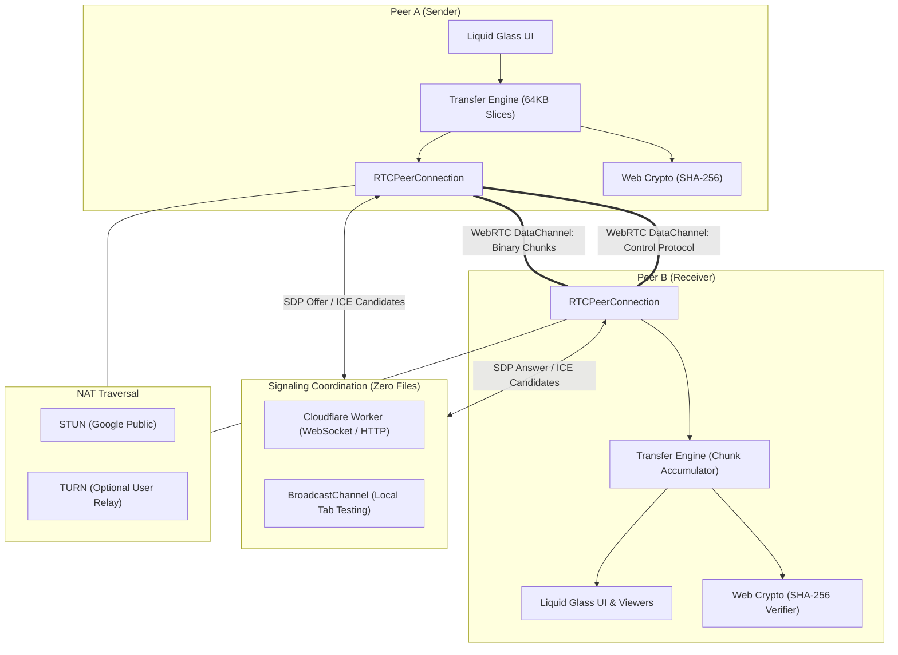

# ShareX System Architecture

## 1. Core Architectural Pillars

### 1.1 Storage-Free Architecture
- **Zero Cloud File Storage**: Neither file metadata nor file contents are ever stored on a centralized server or in a database.
- **Direct P2P WebRTC DataChannel**: File contents are sliced into 64KB binary chunks and piped directly through the peer-to-peer data transport layer.
- **Strict Role of Signaling**: The Cloudflare Worker handles ephemeral session negotiation only (SDP offers, answers, ICE candidates, and temporary pairing rooms). A payload length guard enforces a 64KB limit to ensure binary transfer over signaling is impossible.

### 1.2 Dual-Channel WebRTC Architecture
Every ShareX connection instantiates two separate `RTCDataChannel` channels:
1. `sharex-control` (JSON, reliable, ordered):
   - Ephemeral device handshakes
   - File metadata transfer (`file_start`: name, size, type, expected SHA-256)
   - Transfer orchestration (`transfer_pause`, `transfer_resume`, `transfer_cancel`)
   - Completion notifications (`file_end`)
2. `sharex-transfer` (ArrayBuffer, reliable, ordered):
   - High-throughput binary chunk streaming
   - Low-latency chunk delivery with backpressure monitoring

### 1.3 Backpressure & Memory Protection
To prevent browser memory leaks or tab crashes when sending multi-gigabyte files:
- Sender monitors `dataChannel.bufferedAmount`.
- If `bufferedAmount` exceeds 8MB, sending is paused.
- Sender registers `dataChannel.onbufferedamountlow` with a 2MB threshold to drain the network queue before reading further slices from disk.
- Receiver writes chunks directly into `Blob` sequences and IndexedDB/Memory slices, immediately freeing processed byte buffers.

### 1.4 Cryptographic Verification
- Each transfer triggers `crypto.subtle.digest('SHA-256', ...)` on the source file.
- The sender transmits the expected digest in the `file_start` control message.
- Upon receiving 100% of chunks, the receiver calculates the SHA-256 digest of the assembled blob.
- If the digests match, the transfer is certified with a green verified badge.

### 1.5 Adaptive Performance Engine
- **Auto Optimization**: Detects device capabilities, touch support, and frame rates.
- **Battery Saver**: Turns off ambient background canvas particles, reduces CSS blur complexity, and throttles non-essential animations.
- **Ultra Experience**: Enables high-density particle meshes, interactive cursor glow, and rich 3D glass cards.
